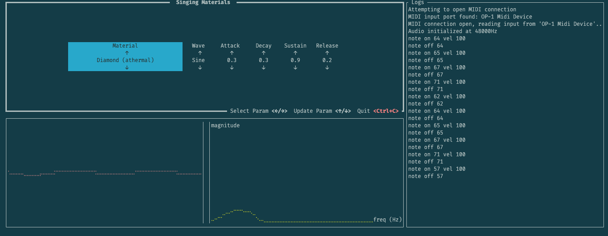

# SingingMaterials TUI

Bare bones Terminal UI for use in testing while developing the [Singing Materials Synth Engine](https://github.com/rlundquist3/synths/tree/main/dsp-core/src/engines/singing_materials) from https://github.com/rlundquist3/synths. Look there for DSP details.

This is a development/testing tool, not a polished instrument. It has no filtering or effects, just a few voices and an envelope.

See https://github.com/lucydot/SingingMaterials for more about the theory behind the project.

### Dependencies

This depends on https://github.com/rlundquist3/synths, which is under active development. The dependency is pulled in through git at a certain commit for the purpose of stability. If materials are added or the engine is otherwise updated in that repo, the commit will need to be updated in `Cargo.toml` here for the changes to take effect.

### Running

At this time, MIDI may be used for note events, but not control change events (i.e. you can use MIDI to play, but not yet to change parameters). If you have a MIDI controller, plug it in prior to startup, and it should be automatically found.

Requires [Rust & Cargo](https://doc.rust-lang.org/cargo/getting-started/installation.html)

```bash
cargo build
cargo run
```

This will open the application's UI in your terminal.

In the log section, you should see

```
Attempting to open MIDI connection
MIDI input port found: {your controller}
MIDI connection open, reading input from '{your controller}'
Audio initialized at {sample rate of your default output device}Hz
```

- use the arrow keys to change the engine/envelope parameters
- play notes with your MIDI controller (up to 6 voices at this time)


